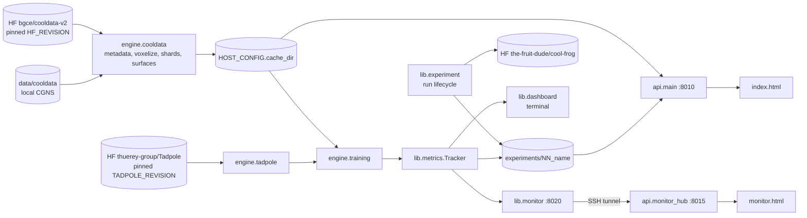

Generated from 204e2ae on 2026-11-07

Working tree: untracked `tests/test_smoke.py` and `notebooks/voxelization_docs_vs_triangulated.ipynb` are not in the recorded commit.

# Coolfrog architecture

Concepts and workflows: [system-overview.md](system-overview.md). File locations: [module-map.md](module-map.md).

## Components

| Component | Role |
|---|---|
| `engine.cooldata` | Design catalogue (`CoolMetadata`), voxel dataset (`CoolData`), HDF5 shard cache (`CoolDataShard`), DataLoader factory, UI surface meshes (`SurfaceMesh`) |
| `engine.tadpole` | `Tadpole` nn.Module around `tadpole.model.autoencoder.TadpoleAutoencoder`: per-channel encode/decode, tiling, solid filling, LoRA adapters |
| `engine.model_evaluation` | Metric tables and the differentiable training loss `fluid_mse` |
| `engine.training` + `training_metrics` | LoRA fine-tuning loop, crops, optimizer, validation, tracker tables |
| `experiments.*` | Experiment scripts and shared setup (`src/coolfrog/experiments/autoencoding.py`) |
| `lib.experiment` + `lib.huggingface` | Run folders, metadata, history, resume, stages, HF commits |
| `lib.metrics`, `lib.dashboard`, `lib.monitor`, `lib.plots` | Tracking, terminal UI, loopback web API, every non-image plot |
| `api.main` | Explorer backend: metadata, sampling, fields, surfaces, zero-shot reconstructions, experiment tables |
| `api.monitor_hub` | Local monitor backend: SSH host config, tunnels, proxy, SVG figures |
| `frontend/` | React 19 + Vite + Tailwind 4, vtk.js for volumes/surfaces, React Three Fiber for teaching scenes |

## Data flow

### Catalogue

`CoolMetadata.load(n_splits, idx_split)` (cached per process):

1. Downloads the official `metadata.parquet` once to `cache_dir/official_metadata.parquet`
2. Joins `src/coolfrog/engine/design_rows.csv` (`design_id, run, batch, row`) on the official row index, since simulation files are named by design id only
3. Deduplicates: repeated parameter sets, then repeated `design_id`, keeping the earlier run
4. Sorts by `design_id`, keeps every `n_splits`-th design from `idx_split`. Splits are disjoint and cover all designs

`select(ranges, n_samples, seed)` filters inclusive ranges (None = open side), sorts by `design_id`, then samples seeded and re-sorts.

### Voxelization and cache

`CoolData(metadata, config)`:

- `config.cache=True` (default) runs `build_voxel_cache`, then reads rows from shards
- `config.cache=False` voxelizes from local `config.source` on every access, ValueError without a source

`build_voxel_cache` contract:

- Exclusive `fcntl` lock `voxels_<X>x<Y>x<Z>/build.lock`: concurrent builds (one per GPU process) wait, then find designs cached
- Deletes leftover `*.tmp` shards, voxelizes only uncached designs, ordered by run and batch
- `forkserver` pool of `PROCESSES = cpus - 2`, workers ignore SIGINT. Entry scripts need an `if __name__ == "__main__":` guard because the forkserver imports them
- Disk check before and after every shard: one uncompressed shard first, then projection from ≥ 3 full shards + 10 % margin, `OSError` when short
- Shards of 64 designs, written via temp file and rename. A failure or Ctrl+C keeps finished shards, the next call resumes

`CoolDataShard.voxelize`: reads the CGNS volume with pyvista, triangulates polyhedra (VTK's polyhedron test is ~10× slower and wrong for ~2 % of points), samples a structured grid with wall points moved `1e-7` m inside. Output `(C, X, Y, Z)` float32 fields plus `vtkValidPointMask` as fluid mask. HDF5 datasets `design_id`, `fields`, `mask`, one blosc2-zstd chunk per design, opened per read so DataLoader workers stay safe.

### Normalization

`NormalizationStats` (tensorclass) maps `[low, high]` to `[-1, 1]`, `log10` first for log channels with values floored at `LOG_FLOOR = 1e-10`. No clipping. Training uses `experiments/01_cooldata-value-distribution/results/normalization_stats.csv` and `excluded_designs.csv` on every host (`PATH_VALUE_DISTRIBUTION`). `FlowField.normalize` raises when already normalized. The explorer API instead normalizes each design by its own fluid min/max (Tadpole's pre-training range).

### Model

`Tadpole.encode`: fill solids by repeated 3×3×3 fluid-neighbour averaging (Tadpole has no mask input), split into tiles of `encoder_crop_size` (must divide every longer axis), run each channel as a scalar field in chunks of `max_internal_batchsize`. Latent `(B, C, L, X/16, Y/16, Z/16)`. `decode(sample=False)` uses the latent mean.

Memory measures:

- Activation checkpointing is decided in training, not configured: `activate_checkpoint_if_needed` probes one pass without it before the first update, any process out of memory -> `Tadpole.enable_checkpointing()` on all (blocks, norm-activations, attention, encoder stem recomputed in backward, ~25 % slower, bit-identical gradients). The choice lands in `run.log` and the tracker state `activation_checkpointing`
- `train()` unmerges GIFt LoRA weights in float32 after an eval forward, avoiding bf16 rounding in frozen weights

Weights: `hf_hub_download("thuerey-group/Tadpole", revision=TADPOLE_REVISION)` unless `path_weights`. Warns when newer weights exist. `TADPOLE_REVISION` must match the `tadpole` git rev in `pyproject.toml`, weight revisions change state dict keys.

### Fine-tuning

`fine_tune_autoencoder` (`src/coolfrog/engine/training.py`):

- `RandomCrops` collates in loader workers: one random channel and position per design, crop edge `encoder_crop_size` (None = whole domain), normalized with that channel's stats
- Update = `designs_per_update` crops over all GPUs. Passes per GPU = `designs_per_update / (batch_size × n_gpus)`, must divide evenly, else ValueError
- Loss `fluid_mse + kl_weight × mean KL`, spectral distance logged only
- AdamW, linear warmup then constant. Autocast dtype from `HOST_CONFIG.autocast_dtype` (bf16 default host, float32 on cube1). Evaluation always float32
- Validation at update 0 (zero-shot baseline under LoRA), every `validate_every` and at the end. Writes `checkpoints/adapter_update_<n>.pt`
- Runs inside `run_dashboard` and `serve_monitor` on rank 0

### Metrics

All on fluid voxels, one row per design, one column per channel:

| Metric | Definition | Space |
|---|---|---|
| `nrmse` | 100 × RMSE / reference std | Scale-invariant, so physical or log10 for log channels |
| `mse` | Mean squared error | Normalized, like the training loss |
| `spectral_loss` | Mean L1 of `log1p` FFT amplitudes, solids zeroed | Normalized |

`evaluate` gathers rows from all ranks, sorted by `design_id`.

## Experiment lifecycle

Authoritative description: [`experiments/README.md`](../experiments/README.md). Contracts agents must respect:

- `run_experiment` resolves the folder from the calling script (`__main__.__file__`), so scripts run as modules, never from notebooks
- Folder: `experiments/<NN>_<kebab-title>[_partial]`. Same title on the other data share reuses its index. New titles get `max(index) + 1`
- Rerun archives `config.yaml`, `meta.json`, `results/` and a README copy into `history/<date>_<commit7>/`. The live README is never overwritten
- `resume=True` needs identical `config.yaml` text, else ValueError. Complete runs are never resumed
- Uncommitted changes outside run folders trigger a `[y/N]` prompt, SystemExit without `y` (also without a terminal)
- Each `run.stage(name)` reseeds with `SEED + rank + crc32(name)`, so stages draw the same randomness in any order or resume

| Exit | Local | `meta.json["status"]` | Hugging Face |
|---|---|---|---|
| Success | kept | `complete` | `push_experiment`: one commit uploads large files, moves the previous pushed run to `history/` server-side |
| Exception | kept, trackers saved | `failed` | untouched |
| Ctrl+C, new run | prompt: `y` (or no TTY) undoes the run and restores the archived one, else kept | `interrupted` | untouched |
| Ctrl+C, resumed run | `meta.json` restored, results kept | previous | untouched |
| SIGKILL | kept, trackers ≤ 30 s old | stays `running` | untouched |

Large files = basename globs in `experiments/.gitignore` (`*.npz`, `*.pt`, `*.safetensors`, `*.parquet`). `large_file_patterns` rejects lines with `/` or `!`. `meta.json["hub"]` (`HubEntry`) pins the HF commit. `run.publish(name, frame)` writes `results/<name>.csv` and replaces the `<!-- table: name -->` block in the README.

Distributed: rank 0 alone starts/resumes the run, writes files, logs, shows the dashboard and serves the monitor. Other ranks wait at `barrier()` and get an unpersisted tracker. NCCL collective timeout 6 h covers rank-0 prompts and cache builds.

## Tracking and monitoring

- `Tracker`: thread-safe tables (optional `pl.Schema` per table, mismatching rows raise ValueError) plus free-form state. Reserved state keys `progress`, `tables`, `gpus`
- Persisted by `Stage.track` as `<table>.parquet` + `state.json`, atomic temp-and-rename, at most every 30 s and on every exit except SIGKILL
- `request_stop` (dashboard `q`, Ctrl+C) raises KeyboardInterrupt at the next `append` / `set_progress`
- Dashboard crash never stops the work, it continues with plain logging. No TTY = no dashboard
- `serve_monitor`: FastAPI on `127.0.0.1:8020` in a daemon thread, `GET /api/state` (snapshot + `nvidia-smi`), `GET /api/tables/{name}?start=&tail=`. Port taken = warning only, monitor off
- Fine-tuning table: `metrics` (`METRICS_SCHEMA`), one row per train sample of every update and per validation design, each a single channel, `split` = `train` | `validation`, unmeasured columns null. The monitor draws it with `plots.metrics_curves`: train means per update plus EMA, validation medians over designs per channel

## HTTP contracts

### Explorer API `coolfrog.api.main` (port 8010)

| Endpoint | Contract |
|---|---|
| `GET /api/config` | Parameter bounds (finite only, 503 if none), channels with `scale` (`log` for `k`, `ε`), surface channels, grid `dimensions` and `spacing` (400×80×16) |
| `POST /api/sample` | `count` 1–12, `seed` ≥ 0, `ranges` on `PARAM_COLUMNS`. 400 when fewer designs match |
| `GET /api/dataset` | Cached overview: total, header, 40-bin histograms, run counts |
| `POST /api/dataset/summary`, `/rows` | Filter by ranges, digit-prefix `search`, `runs`. Rows sorted, `limit` ≤ 500 |
| `GET /api/designs?id=` | 1–24 ids in request order, 404 for unknown |
| `GET /api/fields/{id}?channel=` | Binary: float32 LE values then uint8 mask, x-fastest (Fortran order). 422 when no finite fluid value |
| `GET /api/reconstruction/{id}[?channel=]`, `/metrics` | Zero-shot Tadpole-B, same layout. Cached in `cache_dir/tadpole_b_zero_shot_400x80x16/<id>.pt` |
| `GET /api/surface/{id}` | Binary: 3 uint32 counts, float32 points, uint32 legacy VTK polygons, float32 face values per surface channel (NaN = absent) |
| `GET /api/experiments`, `/api/experiments/{folder}/tables/{path}` | Reads `experiments/` from disk, live runs included. Path must resolve inside `results/` with suffix `.parquet` / `.csv`, else 404 |

Errors: every exception becomes 500 `{"detail": "<Type>: <message>"}`, which the frontend shows inline. Unknown design → 404. Cached loads run concurrently in the thread pool. Uncached loads (voxelization, VTK readers share state) serialize behind `VTK_QUEUE` and return 499 when the browser disconnected while waiting. Fields read the local `data/cooldata` when it holds the design, else Hugging Face.

### Monitor hub `coolfrog.api.monitor_hub` (port 8015)

| Endpoint | Contract |
|---|---|
| `GET /api/hosts` | Hosts without passwords (`has_password` only) |
| `POST /api/hosts`, `/api/hosts/remove` | Add/replace or remove by address, closes the host's tunnel |
| `GET /api/hosts/monitor/{path}?address=` | Pass-through to the training's `/api/<path>`. Training HTTP errors pass through, unreachable → 502 |
| `GET /api/hosts/monitor/figures/{table}.svg?address=&dark=` | `plots.figure_for_table` rendered by the hub under `plot_theme`, 404 when nothing to plot. The hub caches each table's rows and fetches only rows after the cached ones (`?start=`), refetching all when the last cached row changed |

Tunnels: `ssh -N -L <free port>:127.0.0.1:8020`, one per host, reconnected when ssh exited. 502 on SSH failure (`sshpass` exit 5 = wrong password), 504 after 15 s.

Vite dev server (5173) proxies `/api/hosts` to 8015 before `/api` to 8010. Both servers bind 127.0.0.1.

## Persistence authority

| Store | Owner | Contents | Notes |
|---|---|---|---|
| HF `datasets/bgce/cooldata-v2@49d714f…` | upstream | `metadata.parquet`, `runs/<run>/<batch>.zip` CGNS | Pinned `HF_REVISION` in `src/coolfrog/engine/cooldata.py` |
| `src/coolfrog/engine/design_rows.csv` | git | design id → official metadata row, run, batch | ~70.9k rows, too large for normal reading |
| `HOST_CONFIG.cache_dir` | `engine.cooldata`, `api.main` | `official_metadata.parquet`, `voxels_<shape>/*.h5` + `build.lock`, `surfaces/<id>.npz`, `tadpole_b_zero_shot_<shape>/<id>.pt` | Repo `.cache/` by default, `/mnt/data/bitzer/.cache` on cube1. Deleting a dir forces rebuild |
| HF `thuerey-group/Tadpole@TADPOLE_REVISION` | upstream | `tadpole_<size>_{encoder,decoder}.safetensors` | HF cache |
| `experiments/<NN>_<name>/` | `lib.experiment`, git | README, `config.yaml`, `meta.json`, CSV/log/PNG results, `history/` | Source of truth for the latest run |
| HF `the-fruit-dude/cool-frog` (private) | `lib.huggingface` | Large run files, same paths, archived runs in `history/` | Every write = one commit on `main`, pinned in `meta.json["hub"]` |
| `monitor-hosts.json` | `api.monitor_hub` | SSH addresses, optional plaintext passwords | Gitignored, written mode 0600 |
| Browser `localStorage` | frontend | Theme (`coolfrog-theme`), sidebar fold state, monitor's selected host (`coolfrog-monitor-host`) and open groups (`coolfrog-monitor-open/<key>`) | Per browser |

## Trust boundaries and security

- All servers bind loopback. Remote trainings are reached only through SSH tunnels from the local hub
- Passwords stay in `monitor-hosts.json` and reach `sshpass` via the `SSHPASS` environment variable, never argv or the page
- Host addresses reject leading `-` and whitespace, so they cannot be parsed as ssh options. `StrictHostKeyChecking=accept-new` trusts a host key on first connect
- Password-less hosts use `BatchMode=yes`, failing instead of prompting
- Experiment table reads are confined to `results/` by resolved-path checks
- `HF_TOKEN` comes from the environment only. `HuggingFaceHub()` raises `MissingTokenError` without it and creates the private repo if missing
- No authentication on the local APIs: anyone with loopback access can read data and trigger voxelization
